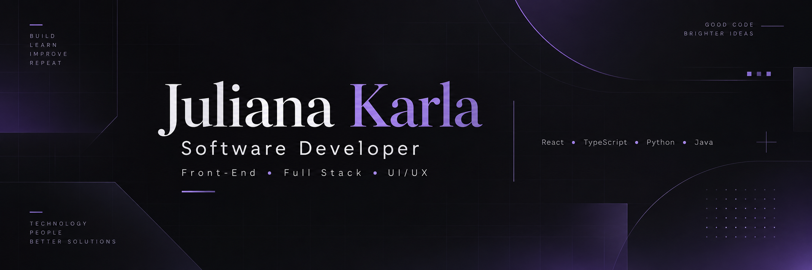

 

  
  
  

## ✦ About me

I'm a **Software Development Intern at 2RPnet** and a **Systems Analysis and Development** student, currently working with **Front-End development**. I enjoy crafting accessible interfaces, solving problems with code, and learning how software works across the stack.

- 💜 **Main interests:** Front-End, Full Stack, UI/UX, Back-End and automation
- 🛠️ **Experience:** web development, API integration, data analysis and technical documentation
- ☁️ **Exploring:** cloud computing, software architecture and developer tooling
- 🎨 **Creative side:** interfaces, illustration and narrative-driven games

## ✦ Tech stack

**Front-End & Design**

**Back-End & Data**

**Tools & Cloud**

## ✦ Projects & interests

| Project | Focus | Status |
| :--- | :--- | :--- |
| **Cuida Fácil** | Caregiver-matching web application · React, TypeScript, UI/UX | In development |
| **A Biblioteca das Almas** | Dark-fantasy 2D game · Java, object-oriented programming | In development |
| **Cloud & IoT Labs** | AWS, Docker, Python, MQTT, APIs and telemetry | Learning projects |

> I'm documenting and polishing these projects for my public portfolio. Meanwhile, explore my [public repositories](https://github.com/Jukamargo?tab=repositories).

## ✦ GitHub overview

Statistics depend on publicly available GitHub data and an external badge service.

---

### ✧ Let's build something meaningful ✧

Open to learning, collaboration and connecting with other developers.

<a href="https://www.linkedin.com/in/juliana-karla-camargo-da-silva-1abb6b323/">LinkedIn</a> · <a href="mailto:julianakarla.dev@gmail.com">Email</a> · <a href="https://github.com/Jukamargo?tab=repositories">Projects</a>

